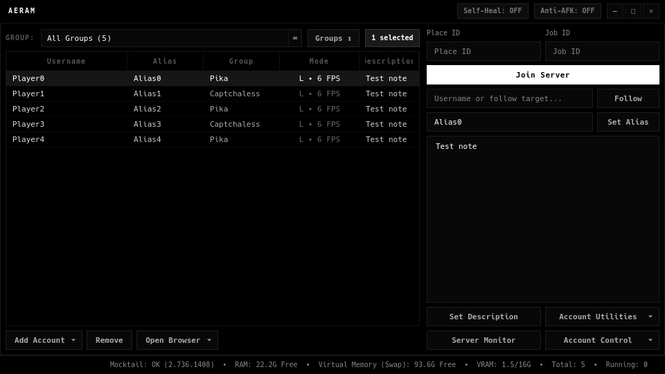

# AERAM

Roblox Account Manager for Linux. Run several Roblox accounts at once, each in its own isolated
[Mocktail](https://github.com/komaruworld/mocktail) instance.



- Encrypted account vault (passwords and `.ROBLOSECURITY` cookies, libsodium)
- Launch many accounts at once; join by Place ID / Job ID or follow a user
- Per-account graphics, FPS and FastFlags
- 2FA (TOTP) codes, groups, aliases and notes
- Anti-AFK, auto-reconnect and server browser

## Install

**1. Dependencies (Arch / CachyOS)**

```bash
sudo pacman -S --needed python python-pyqt6 python-pyqt6-webengine python-pynacl python-evdev \
    base-devel git cmake ninja pkgconf lld sdl3 sdl3_ttf mesa curl openssl nlohmann-json libyaml \
    libelf minizip capstone gtk4 libadwaita webkitgtk-6.0 libutf8proc fontconfig libglvnd \
    libplacebo vulkan-headers vulkan-icd-loader zlib
```

Other distros: the same Python packages (PyQt6, PyQt6-WebEngine, PyNaCl, evdev) plus the packages from
Mocktail's [Build from source](https://github.com/komaruworld/mocktail#build-from-source) section.

**2. Installer**

```bash
git clone https://github.com/vysaely/aeram.git
cd aeram
./install.sh
```

The installer builds Mocktail with AERAM's patches (hardware cursor, 1 ms input, no 240 FPS cap, lower CPU use,
one Enter to send chat, zoom in shift lock, in-game blocking works)
and adds AERAM to your app launcher. Run it again to update.

Already have Mocktail from the AUR (`mocktail-bin`) or a `.deb`/`.rpm`? Use `./install.sh --no-mocktail`.
The Flatpak and AppImage versions of Mocktail can't run several accounts at once.

## Usage

```bash
aeram         # open the app
aeram --help  # command-line options
```

Uninstall: `./install.sh --uninstall` (your accounts in `~/.local/share/aeram` are kept).

## License

[GPL-3.0](LICENSE)
