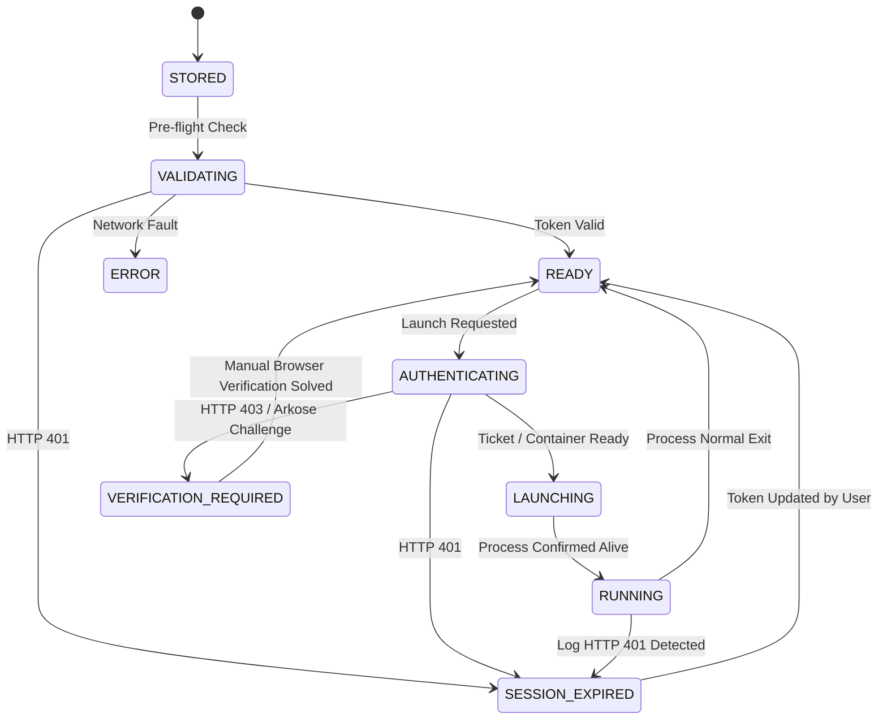

# AERAM — Authentication & Session Security Architecture Review

**Document Version:** 1.0.0  
**Repository:** `https://github.com/vysaely/aeram.git`  
**Scope:** Comprehensive review of credential storage, session isolation, token lifecycle, browser authentication, and anti-abuse compliance across Linux and Windows.

---

## 1. Executive Security Evaluation

AERAM operates under a strict **Zero-Password Policy**: the application never prompts for, stores, collects, or transmits user account passwords. Authentication is maintained exclusively via encrypted `.ROBLOSECURITY` session tokens.

The Windows port introduced both notable security improvements (such as the 9-state authentication lifecycle and encrypted `.aeram` archive migrations) and platform-specific session isolation compromises inherent to the native Windows Roblox client.

---

## 2. Per-Account Session Isolation: Linux vs Windows

### 2.1 Linux Container Sandboxing (Mocktail / Wayland)
On Linux, session isolation is hardware and kernel-enforced:
1. **Isolated Cookie Paths:** Every account is assigned a dedicated profile root:
   `~/.local/share/ram-linux/instances/acc_<id>/`
   Inside this sandbox, `MOCKTAIL_COOKIE_FILE` points directly to an isolated `roblox.cookie` file created with mode `0600`.
2. **Isolated Environment & Sockets:** Each instance is given isolated `XDG_DATA_HOME`, `XDG_CONFIG_HOME`, `XDG_STATE_HOME`, `XDG_CACHE_HOME`, and `XDG_RUNTIME_DIR`.
3. **Decoupled Engine Locks:** Each account executes via a dedicated hardlinked binary (`mocktail_acc_<id>`), completely decoupling the FNV-1a single-instance lock.
4. **Cgroups Resource Confinement:** Alt accounts are confined via `systemd-run -pMemoryHigh=900M`, `CPUWeight=1`, and core pinning (`AllowedCPUs`), preventing any instance from starving the desktop or adjacent sessions.

**Result:** Cross-instance session pollution or credential collision on Linux is physically impossible.

### 2.2 Windows 11 Shared Environment (`RobloxPlayerBeta.exe`)
On Windows 11, all Roblox instances run under the current user's desktop session and share global filesystem locations:
1. **Shared SQLite Store:** All client instances read and write to:
   `%LOCALAPPDATA%\Roblox\LocalStorage\RobloxCookies.dat`
2. **Session Bleed Risk:** When multiple instances start concurrently, they race to write their single-use session tickets into `RobloxCookies.dat`. If an instance starts unauthenticated, it inherits the session left behind by whichever account last wrote to the file.
3. **Shared Graphics & FastFlags:** All instances share `GlobalBasicSettings_13.xml` and `ClientAppSettings.json`.

**Architectural Conclusion:** The original Linux architecture provides infinitely superior session isolation. Windows multi-instance operation relies on pre-empting the singleton synchronization object (`ROBLOX_singletonEvent`) and hoping client processes do not corrupt shared state during concurrent launch spikes.

---

## 3. Cryptographic Vault & At-Rest Security

### 3.1 Linux Cryptography: Libsodium & Argon2id
- **Master Key Generation:** Generated using `os.urandom(32)` and stored in `~/.local/share/ram-linux/vault.key`.
- **Permissions:** Strict POSIX `0600` permissions on the keyfile and `0700` on the base directory.
- **Symmetric Encryption:** Authenticated encryption using `crypto_secretbox_easy` (XSalsa20-Poly1305 with random 24-byte nonce).
- **Key Derivation (KDF):** Argon2id (`crypto_pwhash`) with 64 MB memory limit and opslimit 3 for password-based derivation.
- **Fallback Integration:** The Windows port introduced `pynacl` as a seamless fallback if system `libsodium.so` is not found on `ctypes.CDLL` paths. This improves Linux portability across minimal distributions (e.g. Alpine, Arch minimal).

### 3.2 Windows Cryptography: DPAPI
- On Windows, `vault.key` is protected at rest via Windows Data Protection API (`CryptProtectData` / `CryptUnprotectData`).
- DPAPI ties the encryption key to the Windows user's login credentials and machine LSA secrets.
- **Verdict:** DPAPI is well-suited for Windows desktop applications, but has zero utility on Linux. Linux POSIX permissions + disk encryption (LUKS) provide standard, auditable user security.

---

## 4. Authentication Lifecycle State Machine (`core/auth_state.py`)

Prior to commit `47b6bfd`, AERAM had a rudimentary binary understanding of account state (idle vs running). If an account received a CAPTCHA or expired cookie, background loops (multi-launch queues or the Self-Healing watchdog) would repeatedly attempt to re-launch it.

The 9-state machine introduced in `core/auth_state.py` solves this completely:

### Safety Enforcements:
1. **Automated Retry Suppression:** When state is `VERIFICATION_REQUIRED`, `can_launch(account_id)` returns `False`. The Self-Healing watchdog and multi-launch loops immediately skip the account, preventing Arkose CAPTCHA storms and Akamai IP bans.
2. **Launch Deduplication:** `acquire_launch_lock(account_id)` prevents race conditions where double-clicking or rapid API triggers attempt to launch the same account twice.
3. **Session Preservation:** Under both `VERIFICATION_REQUIRED` and `SESSION_EXPIRED`, stored `.ROBLOSECURITY` tokens are **never deleted**. The user can inspect diagnostics and update the cookie at their convenience.

**Verdict:** `core/auth_state.py` is a top-tier improvement that must be **KEPT** and maintained on Linux.

---

## 5. Browser-Based Account Login (`ui/web_login_dialog.py`)

### 5.1 Mechanics & Security Analysis
- **Implementation:** Embedded Qt WebEngine Chromium view pointing to `https://www.roblox.com/login`.
- **Credential Interception:** Intercepts `.ROBLOSECURITY` when set in `QWebEngineProfile.cookieStore().cookieAdded`.
- **Off-the-Record Isolation:** Uses an in-memory, off-the-record profile so browser cache and cookies do not persist to disk outside AERAM's vault.
- **Zero-Password Compliance:** AERAM never interacts with form inputs, never logs keystrokes, and does not capture user passwords.
- **MFA & CAPTCHA Support:** The user completes MFA, passkeys, and Arkose FunCAPTCHA puzzles directly inside genuine Chromium with full JavaScript and WebGL execution.

### 5.2 Architectural Tradeoffs & Linux Assessment
While the feature works cleanly on Windows where `PyQt6-WebEngine` is bundled in PyInstaller, it presents several serious challenges on Linux:
1. **Heavyweight Dependency:** `PyQt6-WebEngine` adds ~150–250 MB of binary weight and pulling it as a mandatory dependency breaks lightweight installations.
2. **Current Implementation Bug:** When `PyQt6-WebEngine` is missing, `_init_fallback_ui` fails to create `self.status_label`, leading to crashes upon any cookie update.
3. **OpenGL Compatibility:** Requires `AA_ShareOpenGLContexts` which can conflict with Wayland and direct-Vulkan Mocktail rendering pipelines.

### 5.3 Recommendation:
- **ADAPT** the feature for Linux:
  1. Fix the fallback UI defect so running without WebEngine is 100% stable.
  2. Gate `PyQt6-WebEngine` strictly as an optional plugin/package (`pip install aeram[browser]`).
  3. Support an alternative, lightweight external browser bridge (e.g. local loopback redirect server) for headless or minimal setups.

---

## 6. Secure Account Migration (`core/migration.py`)

The Windows port introduced `core/migration.py`, providing the `AERAM_VAULT_EXPORT_V1` encrypted archive format.

### Security Properties:
- **Zero Plaintext Tokens:** Plaintext `.ROBLOSECURITY` cookies are never written to unencrypted JSON or CSV exports.
- **Strong Cryptographic Wrapper:**
  - Header: Magic header `AERAM_VAULT_EXPORT_V1\n` (22 bytes)
  - Salt: 16 cryptographically random bytes (`os.urandom(16)`)
  - KDF: Argon2id with 64 MB memory cost, 3 iterations
  - Encryption: XSalsa20-Poly1305 authenticated ciphertext
- **Tamper Resistance:** Any bit modification to the export file results in an authenticated `WrongPasswordError` or `VaultCorruptError`.

**Verdict:** 100% portable, highly secure, and valuable for Linux users backing up or migrating vaults across workstations. **KEEP**.

---

## 7. Credential Exposure Audit

A systematic scan of logs, process arguments, and diagnostics was conducted:
1. **Process Arguments:**
   - Linux: Mocktail is invoked with `--windowed --graphics opengl`. The cookie is passed via `MOCKTAIL_COOKIE_FILE` pointing to a mode `0600` file. It is **never** passed on the command line, ensuring credentials are not visible in `ps aux` or `/proc/<pid>/cmdline`.
   - Windows: Client is launched via `roblox-player:` URI with single-use `gameinfo:<ticket>`. The ticket expires immediately upon redemption.
2. **Logging:**
   - All loggers (`InstanceRunner`, `StorageManager`, `WebLoginDialog`, `RobloxAPI`) sanitize cookie values.
   - Cookies are never logged in plaintext.
3. **Terminal Output:**
   - CLI outputs display only masked account summaries (Username, Display Name, Robux Balance, Group). Plaintext cookies are never dumped.

---

## 8. Summary of Authentication Subsystem Decisions

| Component | Security Rating | Linux Suitability | Final Action |
|---|---|---|---|
| `core/auth_state.py` (9-State Engine) | **Excellent** | **Native / Essential** | **KEEP** |
| `core/migration.py` (Encrypted Archive) | **Excellent** | **Native / Essential** | **KEEP** |
| `core/roblox_api.py` (Diagnostics & Status) | **Good** | **Native / Essential** | **KEEP** |
| `core/vault.py` (PyNaCl Fallback) | **Good** | **Native / Useful** | **KEEP** |
| `core/vault.py` (Win32 DPAPI) | **Acceptable (Win only)** | **Not Applicable** | **REMOVE CANDIDATE** |
| `ui/web_login_dialog.py` (Chromium Login) | **Good (Zero-Password)** | **Heavy / Needs Gating** | **ADAPT** |
| `core/roblox_api.py` (Win32 Ticket Minting) | **Standard Win32** | **Unused on Mocktail** | **OPTIONAL** |
