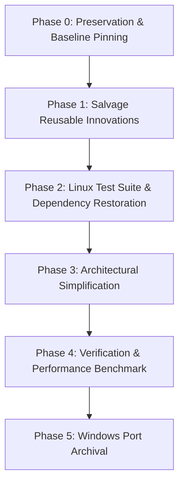

# AERAM — Linux-First Salvage & Migration Plan

**Document Version:** 1.0.0  
**Repository:** `https://github.com/vysaely/aeram.git`  
**Target Milestone:** Linux-First Streamlined Architecture (`v0.3.0-linux-core`)  
**Execution Policy:** Staged, non-destructive execution with validation gates and instant rollback capability at each phase.

---

## 1. Plan Overview & Safety Principles

This migration plan defines the exact technical procedure to transition AERAM from the hybrid/unbalanced Windows port state back into an uncompromised, high-performance Linux application.

### Safety Invariants:
1. **Never mutate live account data:** `manager.db`, `vault.key`, and user instances under `~/.local/share/ram-linux/` are untouched.
2. **Never discard Git history:** Windows port commits and research documents are preserved in dedicated archival tags.
3. **Audit First, Approve Before Executing:** No destructive phase may be initiated without explicit maintainer approval.
4. **Zero Test Regressions:** Every phase must pass 100% of discovered unit tests before proceeding to the next phase.

---

## 2. Phased Implementation Roadmap



---

## Phase 0 — Preservation & Baseline Pinning

### Objective
Ensure that all historical states, uncommitted work, and active user databases are protected against accidental corruption or data loss.

### Target Files & Paths
- User Data: `~/.local/share/ram-linux/manager.db`, `~/.local/share/ram-linux/vault.key`
- User Backup: `~/Roblox_Linux_Milestone_Backup_2026/`
- Git Bundle: `~/aeram_git_checkpoint_20261013.bundle`
- Repository Branches: `main`, `audit/windows-port-salvage`, `checkpoint/pre-github-publication-20261013`

### Exact Implementation Steps
1. Create a permanent archival tag for the complete Windows port on `origin/main`:
   ```bash
   git tag archive/windows-port-20261013 origin/main
   ```
2. Verify that local user database and vault key have strict permissions:
   ```bash
   chmod 0600 ~/.local/share/ram-linux/vault.key ~/.local/share/ram-linux/manager.db
   ```
3. Establish a dedicated working branch for the salvage refactor:
   ```bash
   git checkout -b salvage/linux-first-core origin/main
   ```

### Risks & Mitigations
- *Risk:* Overwriting active SQLite database during testing.
- *Mitigation:* All unit tests use `tempfile.TemporaryDirectory` and isolate their storage paths.

### Rollback Procedure
If any branch issues occur, reset to `archive/windows-port-20261013` or restore from `~/aeram_git_checkpoint_20261013.bundle`.

---

## Phase 1 — Reusable Innovations Salvage

### Objective
Incorporate the four major verified innovations developed during the Windows port into the Linux core.

### Exact Modules to Retain
1. **`core/auth_state.py`**:
   - `AccountAuthState` (9-state machine)
   - `AccountAuthStateManager` (thread-safe lifecycle tracker, retry suppression, launch deduplication)
2. **`core/migration.py`**:
   - `export_accounts_encrypted` and `decrypt_aeram_export` (`AERAM_VAULT_EXPORT_V1`)
   - CLI flags `--export` and `--password` in `cli.py`
3. **`core/roblox_api.py` Enhancements**:
   - Structured error classification in `validate_cookie(cookie) -> Tuple[bool, Optional[Dict], str]`
   - HTTP 401, 403 (challenge), 429 status code handling
4. **Branding & UI Enhancements**:
   - Achromatic `ae` ligature icons (`assets/aeram.svg`, `assets/aeram.png`, `assets/aeram.ico`)
   - UI status badges, "Validate Session" action, and "Export Encrypted Archive" dialog in `ui/main_window.py`
5. **Cryptographic Vault Fallback**:
   - PyNaCl fallback in `core/vault.py` when system libsodium is absent.

### Validation Requirements
- `tests/test_migration.py` passes 3/3 tests.
- `tests/test_vault.py` passes 5/5 tests.

---

## Phase 2 — Linux Test Suite & Dependency Restoration

### Objective
Fix the 3 test failures on Linux, eliminate broken top-level imports, and make `PyQt6-WebEngine` strictly optional.

### Target Files to Modify
1. **`tests/test_auth_lifecycle.py`**:
   - Convert from `pytest` syntax to standard library `unittest.TestCase`.
   - Remove `import pytest` and replace fixtures with `setUp()`.
2. **`ui/web_login_dialog.py`**:
   - Fix `_init_fallback_ui` bug: ensure `self.status_label` is always created so `_process_detected_cookie` never raises `AttributeError`.
   - Add graceful warning if `PyQt6-WebEngine` is missing, without blocking the rest of the application.
3. **`tests/test_windows_native.py` & `tests/test_windows_settings.py`**:
   - Gate Windows imports inside `setUpClass()`:
     ```python
     if sys.platform != "win32":
         raise unittest.SkipTest("Windows-specific test")
     ```
   - Do not import `winreg` or `core.platform.windows` at module top-level.
4. **`tests/test_gui.py`**:
   - Wrap `test_web_login_dialog_lifecycle` with `unittest.skipUnless(WEBENGINE_AVAILABLE, "PyQt6-WebEngine not installed")` or verify fallback behavior cleanly.

### Validation Requirements
- `python3 -m unittest discover -s tests -v` runs and finishes with **0 errors and 0 failures** on Linux.

---

## Phase 3 — Architecture Simplification

### Objective
Eliminate redundant Windows abstraction overhead and restore clean, direct Linux execution.

### Architectural Decisions to Execute:
1. **Streamline `core/instance_runner.py`**:
   - Remove Win32 process supervision branches (`GlobalMemoryStatusEx`, `OpenProcess`, `ctypes.windll`).
   - Cleanly encapsulate Linux Mocktail execution without branching on `sys.platform == "win32"`.
2. **Decouple or Isolate `core/platform/`**:
   - Either absorb Linux primitives back into `core/instance_runner.py` and remove `core/platform/`, OR fully implement `LinuxPlatformProvider` so `instance_runner.py` contains zero platform code.
   - Recommended: Absorb directly into `instance_runner.py` and `storage.py` for maximum simplicity and zero indirection overhead.
3. **Remove Windows Anti-Tamper & Mutex Scaffolding**:
   - Deprecate `core/platform/windows_multi_instance.py` and `core/platform/windows_settings.py`.
4. **Purge DPAPI from `core/vault.py`**:
   - Remove `_win_dpapi_protect` and `_win_dpapi_unprotect`. Preserve POSIX `0600` keyfile management.

### Validation Requirements
- `test_storage.py`, `test_vault.py`, `test_instance_runner.py`, and `test_self_heal.py` all pass cleanly.

---

## Phase 4 — Linux Verification & Performance Benchmarking

### Objective
Certify that the refactored Linux application matches all performance and stability benchmarks established in the original Linux baseline.

### Verification Matrix & Benchmarks:
| Target Metric | Benchmark Standard | Measurement Method |
|---|---|---|
| **Test Suite Pass Rate** | **100% (All Linux tests passing)** | `python3 -m unittest discover -s tests -v` |
| **GUI Polling Latency** | **< 2.0 ms** across 50 accounts | `tests/benchmark_performance.py` |
| **Main-Thread Blocking Calls** | **0 subprocess calls per tick** | Code review & audit |
| **Settings DB Churn** | **0 SQL queries per tick** | In-memory cache assertion |
| **Process Discovery Speed** | **< 3.0 ms** via UID `/proc` scan | Timer benchmark |
| **FD / Handle Leaks** | **0 leaked descriptors on launch** | `lsof -p <pid>` check |

---

## Phase 5 — Windows Port Archival & Repository Cleanup

### Objective
Safely retire Windows-specific packaging and build automation from the active tree while guaranteeing that all Windows code remains accessible in Git history.

### Target Files to Archive / Remove from `main`:
- Build specs: `aeram.spec`, `aeram_portable.spec`, `installer.iss`, `version_info.txt`
- Build scripts: `scripts/build_windows.py`, `scripts/compile_and_install.bat`
- Windows CI: `.github/workflows/windows-build.yml`
- Windows documentation: `docs/windows-port/` (retained in Git history or archived to `docs/archive/`)

### Archival Commands:
```bash
# Tag the complete Windows port before removal
git tag -a archive/windows-port-final -m "Complete Windows 11 port and research documentation"

# Verify all commits are retained
git log -n 1 archive/windows-port-final
```

---

## 3. Immediate Next Action

The audit is complete and all five deliverables are documented. The recommended next step is:
**Wait for owner review and approval before executing Phase 0 through Phase 5.**
