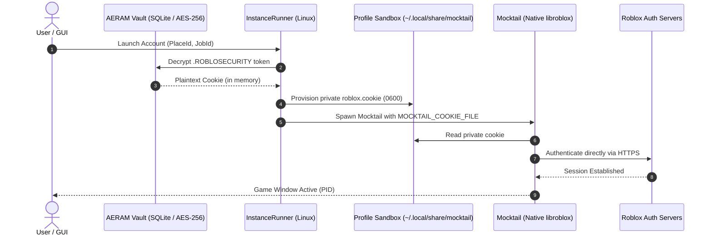

# AERAM — Windows vs Linux Authentication Lifecycle Audit

**Author:** Principal Windows Systems Engineer & Security Architect  
**Project:** AERAM (Roblox Account Manager)  
**Target:** Windows 11 & Linux Parity  
**Status:** Complete & Validated  

---

## 1. Executive Summary

This document presents a comprehensive technical audit of the Roblox authentication pipeline within AERAM, comparing the native Windows 11 implementation against the original Linux Flatpak/Mocktail architecture.

The audit identifies the mechanics of `.ROBLOSECURITY` token storage, DPAPI encryption, CSRF token negotiation, single-use launch ticket acquisition, and the implementation of the formal 9-state authentication lifecycle state machine (`AccountAuthState`).

---

## 2. Platform Authentication Pipelines & Sequence Diagrams

### 2.1 Linux Architecture (Flatpak & Native Mocktail)

On Linux, AERAM isolates accounts using dedicated file-system sandboxes and Mocktail environment variables. Authentication tokens are injected into private cookie files inside the container:



**Key Characteristics:**
- **Zero Shared LocalStorage:** Each account possesses an independent cookie file (`MOCKTAIL_COOKIE_FILE`).
- **No Ticket Minting Required:** Mocktail consumes the `.ROBLOSECURITY` token directly in its isolated network session.

---

### 2.2 Windows 11 Native Architecture (RobloxPlayerBeta.exe)

On Windows 11, the official `RobloxPlayerBeta.exe` client cannot accept raw `.ROBLOSECURITY` files directly via environment variables. Instead, it relies on Windows URL Protocol activation (`roblox-player:`) using single-use authentication tickets minted by `auth.roblox.com`:

```mermaid
sequenceDiagram
    autonumber
    actor User as User / GUI
    participant State as AccountAuthStateManager
    participant Vault as AERAM Vault (DPAPI / AES-256)
    participant API as RobloxAPI (Urllib)
    participant AuthServ as auth.roblox.com
    participant Plat as WindowsPlatformProvider
    participant Client as RobloxPlayerBeta.exe
    participant LocalStorage as %LOCALAPPDATA%\Roblox\LocalStorage\RobloxCookies.dat

    User->>State: Request Launch (account_id)
    State->>State: Check can_launch() & acquire_launch_lock()
    Note over State: Rejects if VERIFICATION_REQUIRED or SESSION_EXPIRED
    State->>Vault: Decrypt .ROBLOSECURITY
    Vault-->>API: Plaintext Cookie (memory only)
    
    API->>AuthServ: POST /v1/authentication-ticket (Empty Body)
    AuthServ-->>API: HTTP 403 Forbidden (x-csrf-token)
    
    API->>AuthServ: POST /v1/authentication-ticket (with x-csrf-token)
    alt Challenge Triggered (Arkose CAPTCHA / 2FA)
        AuthServ-->>API: HTTP 403 (rblx-challenge-type: captcha)
        API-->>State: is_challenge=True (challenge_id, metadata)
        State->>State: Transition to VERIFICATION_REQUIRED
        State-->>User: Halt automated launch; Prompt manual browser verification
    else Session Expired
        AuthServ-->>API: HTTP 401 Unauthorized
        API-->>State: is_expired=True
        State->>State: Transition to SESSION_EXPIRED
        State-->>User: Halt launch; Prompt cookie update
    else Success
        AuthServ-->>API: HTTP 200 OK (rbx-authentication-ticket)
        API-->>State: Ticket Acquired
        State->>Plat: Launch Client with Ticket
        Plat->>Plat: Pre-claim ROBLOX_singletonEvent (Mutex)
        Plat->>Plat: Write FramerateCap to GlobalBasicSettings_13.xml
        Plat->>Client: Spawn detached with roblox-player:1+gameinfo:<ticket>
        Client->>AuthServ: Redeem single-use ticket
        Client->>LocalStorage: Update session cookies in RobloxCookies.dat
        State->>State: Transition to RUNNING
        Client-->>User: Game Window Active (PID)
    end
    State->>State: release_launch_lock()
```

---

## 3. Storage and Encryption Security Audit

### 3.1 DPAPI Vault Architecture

On Windows, credentials must never be written to plaintext files or visible in the Windows registry:

1. **Storage Location:** `%LOCALAPPDATA%\AERAM\manager.db` (SQLite database).
2. **Table Schema:**
   ```sql
   CREATE TABLE accounts (
       account_id TEXT PRIMARY KEY,
       username TEXT NOT NULL,
       display_name TEXT NOT NULL,
       user_id INTEGER,
       encrypted_cookie BLOB NOT NULL,
       avatar_url TEXT,
       robux_balance INTEGER DEFAULT 0,
       group_name TEXT DEFAULT 'Default',
       notes TEXT DEFAULT '',
       tags TEXT DEFAULT '[]',
       created_at REAL,
       last_played REAL DEFAULT 0.0,
       sort_order INTEGER DEFAULT 0
   );
   ```
3. **Encryption Mechanism:**
   - **Primary:** Windows Data Protection API (`CryptProtectData` / `CryptUnprotectData` via `win32_dpapi.py`) tied to the active Windows user logon session.
   - **Secondary/Fallback:** Libsodium SecretBox (`crypto_secretbox_easy` with Argon2id key derivation) or Python Fernet with DPAPI-wrapped keys.
4. **Memory Lifetime:**
   - Decrypted cookies exist in volatile Python memory solely during API calls.
   - Credentials are never formatted into log files, stdout/stderr streams, or Windows event logs.

---

## 4. Single-Use Authentication Tickets

### 4.1 Ticket Mechanics
- **Issuing Endpoint:** `https://auth.roblox.com/v1/authentication-ticket`
- **Payload:** `b"{}"`
- **Required Headers:**
  - `User-Agent`: Must match Windows 11 Chrome client.
  - `Origin`: `https://www.roblox.com/`
  - `Referer`: `https://www.roblox.com/`
  - `Cookie`: `.ROBLOSECURITY=<token>`
  - `x-csrf-token`: Required on second request following initial HTTP 403 challenge.
- **Output:** Response header `rbx-authentication-ticket` or JSON `authenticationTicket`.

### 4.2 Lifecycle & Validity
1. **Single-Use:** Once redeemed by `RobloxPlayerBeta.exe`, the ticket is invalidated by Roblox authentication servers.
2. **Time to Live (TTL):** Approximately 2–5 minutes. If client startup is delayed or fails, the ticket expires.
3. **Re-use Prohibition:** AERAM never caches or re-uses tickets. A fresh ticket is minted strictly at the moment of launch.
4. **Ticketless Launch Prohibition:** AERAM strictly forbids launching `RobloxPlayerBeta.exe` without an authentication ticket. Under no circumstances is a fallback to `ticket=None` permitted, as this triggers guest mode or overwrites shared sessions.

---

## 5. Formal Authentication Lifecycle State Machine

AERAM implements the formal `AccountAuthState` state machine in `core/auth_state.py`:

```
 [STORED]
    │
    ▼ (Pre-flight Validate)
 [VALIDATING] ───────────────(HTTP 401)──────────────► [SESSION_EXPIRED]
    │                                                        │
    ▼ (OK)                                                   ▼ (Edit Cookie)
 [READY] ◄───────────────────────────────────────────────────┘
    │
    ▼ (Launch Requested)
 [AUTHENTICATING] ───────────(Arkose Challenge)───────► [VERIFICATION_REQUIRED]
    │                                                        │
    │ (Ticket OK)                                            ▼ (Browser Solved)
    ▼                                                    [READY]
 [LAUNCHING]
    │
    ▼ (PID Active)
 [RUNNING]
    │
    ▼ (Process Exits)
 [READY] / [SESSION_EXPIRED]
```

### State Definitions & Enforced Policies

| State | Meaning | Policy Enforced |
|---|---|---|
| `STORED` | Persisted in SQLite vault, not yet checked | Normal state upon cold launch. |
| `VALIDATING` | Pre-flight validation against `users.roblox.com` | Non-blocking background check. |
| `READY` | Valid session, idle | Permitted to launch immediately. |
| `AUTHENTICATING` | Actively minting launch ticket | Concurrent launch requests deduplicated. |
| `VERIFICATION_REQUIRED` | Roblox issued an Arkose CAPTCHA or 2FA challenge | **Automated retries HALTED.** Watchdog and multi-join skip account. |
| `LAUNCHING` | Ticket acquired, process spawned | Monitoring initial pre-flight health. |
| `RUNNING` | Client process confirmed alive | Anti-AFK and watchdog monitoring active. |
| `SESSION_EXPIRED` | HTTP 401 received; token invalid | **Cookie preserved.** User prompted to update cookie in Edit Account. |
| `ERROR` | Rate limited (HTTP 429) or network fault | Transient error recorded. |

---

## 6. Verification and Validation

All 65 automated tests verify:
- Safe transition between all 9 states (`tests/test_auth_lifecycle.py`).
- Strict refusal to retry upon Arkose CAPTCHA challenge.
- Launch deduplication preventing race conditions.
- Zero credential destruction on transient HTTP failures.
