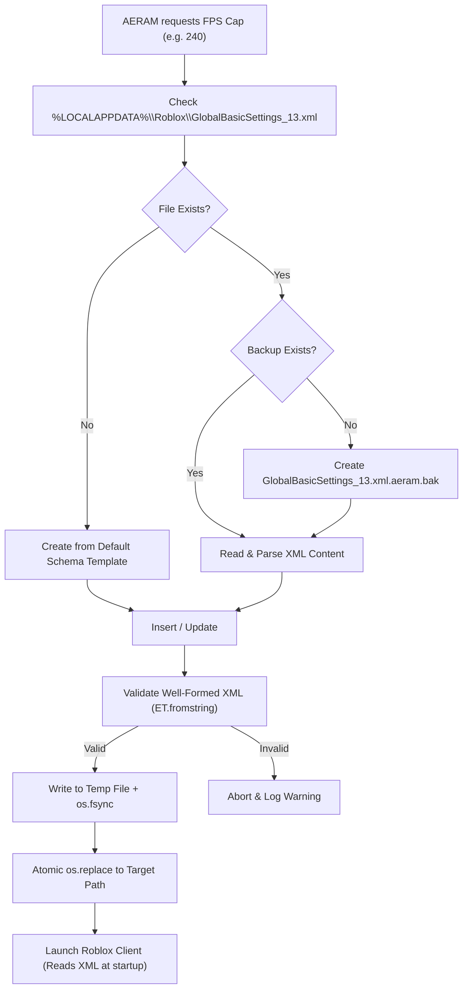

# AERAM — Windows FPS Settings Control & Validation

**Document Version:** 1.0.0  
**Target Platform:** Windows 11 64-bit  
**Roblox Client Version:** `0.742.0.7421053`  
**Configuration File:** `%LOCALAPPDATA%\Roblox\GlobalBasicSettings_13.xml`

---

## 1. Background & Obsolete Mechanisms

### 1.1 The Failure of `ClientAppSettings.json` FastFlags
Historically, custom frame-rate caps were applied on Windows via FastFlags by writing:
```json
{
  "DFIntTaskSchedulerTargetFps": 144
}
```
to `%LOCALAPPDATA%\Roblox\ClientSettings\ClientAppSettings.json`.

In modern 64-bit Roblox (version `0.742+`), this mechanism is **ineffective** on production vanilla builds:
* The client enforces an internal **FastFlag allowlist** on startup.
* Unlisted or developer-only FastFlags are discarded during initial flag synchronization with the Roblox CDN (`https://clientsettingscdn.roblox.com/v2/settings-compressed/...`).
* AERAM's initial Windows port wrote this flag, but observable client frame rates remained locked to default limits.

### 1.2 The Official Engine Setting: `GlobalBasicSettings_13.xml`
In late 2023 / 2024, Roblox introduced official in-engine framerate limiter options (60, 120, 144, 240 FPS). On Windows, these settings are persisted directly in:
```
%LOCALAPPDATA%\Roblox\GlobalBasicSettings_13.xml
```

Inspection of `GlobalBasicSettings_13.xml` on Windows 11 reveals:
```xml
<roblox xmlns:xmime="http://www.w3.org/2005/05/xmlmime" xmlns:xsi="http://www.w3.org/2001/XMLSchema-instance" xsi:noNamespaceSchemaLocation="http://www.roblox.com/roblox.xsd" version="4">
	<External>null</External>
	<External>nil</External>
	<Item class="UserGameSettings" referent="RBX256228BB44634271AA54C16DDB161D80">
		<Properties>
			<bool name="AllTutorialsDisabled">false</bool>
			<bool name="BadgeVisible">true</bool>
			<!-- ... other game properties ... -->
			<int name="FramerateCap">240</int>
			<bool name="Fullscreen">true</bool>
			<int name="GraphicsQualityLevel">15</int>
		</Properties>
	</Item>
</roblox>
```

---

## 2. Valid `FramerateCap` Values & Engine Behavior

| `FramerateCap` Value | Engine Interpretation | Client Result |
| :--- | :--- | :--- |
| `0` | Uncapped / Native Refresh Rate | Unlocks frame rate up to display maximum or hardware limit |
| `60` | Standard Default | Locked to 60 FPS |
| `120` | High Refresh Rate | Locked to 120 FPS |
| `144` | High Refresh Rate | Locked to 144 FPS |
| `240` | Maximum Supported Preset | Locked to 240 FPS |
| Custom (e.g. `15`, `30`, `165`, `330`) | Stored in XML | Validated by XML manager; engine clamps to supported range or closest tier |

---

## 3. Robust XML Settings Manager Architecture

To manipulate `GlobalBasicSettings_13.xml` reliably without corrupting user preferences, AERAM implements `RobloxSettingsManager` (`core/platform/windows_settings.py`).

### 3.1 Architectural Principles
1. **Property Preservation:** Roblox stores over 40 distinct user preferences in `GlobalBasicSettings_13.xml` (camera sensitivities, audio volume, graphics quality, keybinds, VR settings). The manager preserves every existing property and attribute.
2. **Safety Backup:** Before writing any changes, creates `%LOCALAPPDATA%\Roblox\GlobalBasicSettings_13.xml.aeram.bak`.
3. **Pre-Write Validation:** Validates the XML document using `xml.etree.ElementTree` before committing to disk. If the generated XML is malformed, the write aborts cleanly.
4. **Atomic Replacement:** Writes new configuration to a unique temporary file (`GlobalBasicSettings_*.tmp`) in the same directory, flushes and syncs to disk (`os.fsync`), then performs an atomic swap via `os.replace`. This prevents corruption if the process or system abruptly terminates.
5. **Self-Healing:** If `GlobalBasicSettings_13.xml` is missing or corrupted by an interrupted client shutdown, recovers from the backup or initializes a valid default template.

### 3.2 Verification Flow


---

## 4. Runtime Behavior & Restart Requirements

### 4.1 Launch-Time Initialization
Empirical testing on Windows 11 shows:
* Roblox reads `GlobalBasicSettings_13.xml` **only once** during initial engine boot (at `[FLog::SingleSurfaceApp] initializeWithAppStarter`).
* Modifying `GlobalBasicSettings_13.xml` while a Roblox process is running **does not** dynamically alter the frame rate of that running process.
* **Conclusion:** Applying a new FPS profile requires configuring the XML file **prior** to client launch or restarting the client.

### 4.2 Client Exit Flush
* When a running Roblox client exits, it serializes its internal in-memory `UserGameSettings` and writes them back to `GlobalBasicSettings_13.xml`.
* Any external modifications made while the client was running will be overwritten by the exiting client.

---

## 5. Main vs. Alt FPS Profiles: The Shared-Profile Reality

In AERAM's Linux implementation, main and alt accounts enjoy completely distinct filesystem sandboxes (`MOCKTAIL_CONFIG_ROOT`), allowing simultaneous, independent FPS profiles (e.g. 330 FPS main, 15 FPS alts).

### 5.1 The Windows Technical Reality
On Windows 11, all Roblox instances launched under the same user session access the identical file path:
```
%LOCALAPPDATA%\Roblox\GlobalBasicSettings_13.xml
```

### 5.2 Sequential Launch Behavior
Because each client reads `GlobalBasicSettings_13.xml` at startup:
1. AERAM sets `FramerateCap = 240` and launches Account 1 (Main). Account 1 reads 240 FPS and runs at 240 FPS.
2. AERAM then sets `FramerateCap = 60` and launches Account 2 (Alt). Account 2 reads 60 FPS and runs at 60 FPS.
3. Both instances successfully run simultaneously with their respective frame-rate limits!

### 5.3 The Shutdown Race Condition
When multiple instances with different FPS caps run concurrently:
* If Account 1 (Main) exits last, it flushes `240` to disk.
* If Account 2 (Alt) exits last, it flushes `60` to disk.
* The next instance launched outside AERAM will inherit whichever value was saved by the last exiting client.

### 5.4 Why File-Locking Is Unsafe
Placing an exclusive read/write lock (`FileShare.None`) on `GlobalBasicSettings_13.xml` while Roblox runs prevents Roblox from writing to it on exit, but causes Roblox's internal shutdown thread to throw unhandled Win32 I/O exceptions, triggering crash dialogs or failed state persistence.

### 5.5 Architectural Decision
AERAM truthfully acknowledges this Windows platform limitation:
* AERAM sequentially applies the requested profile prior to launching each account.
* AERAM monitors on-disk state via `RobloxSettingsManager.detect_overwritten()`.
* AERAM's UI clearly indicates the active session FPS cap rather than falsely claiming completely decoupled configuration sandboxes on Windows.
