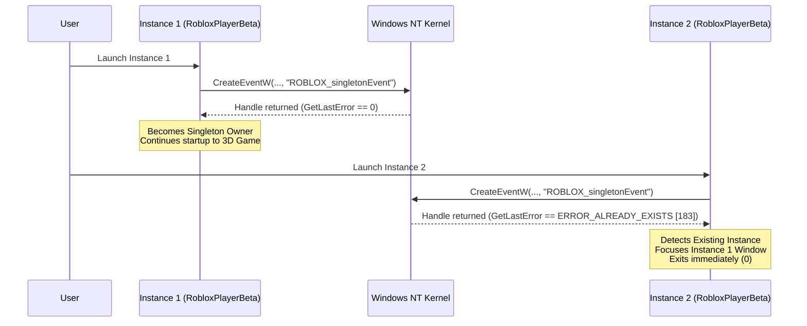

# AERAM — Windows Multi-Instance Technical Research & Architecture

**Document Version:** 1.0.0  
**Target Platform:** Windows 11 64-bit  
**Analyzed Runtime:** Roblox 64-bit client (`0.742.0.7421053`) with Hyperion / Byfron Anti-Cheat  
**Reference Implementations Audited:**
- `MultiBloxy` (Zgoly) — C# .NET Tray Application
- `MultiBlox` (imdaclassic) — Python / Tkinter Win32 Tool
- `Roblox-Multi-Instance` (IDKDeadXD) — Node.js / PowerShell Electron Wrapper

---

## 1. The Roblox Singleton Architecture on Windows

Unlike Linux where Mocktail or container runtimes provide process-level namespace isolation, Roblox on Windows runs directly on the Win32 subsystem. To enforce its single-instance rule, Roblox uses kernel synchronization primitives in the user's desktop session.

### 1.1 The Named Synchronization Primitive
Empirical inspection of running Roblox processes (PID `2616`) via `NtQueryObject` and `OpenEventW` reveals:
* **Object Name:** `ROBLOX_singletonEvent`
* **Full Object Directory:** `\Sessions\1\BaseNamedObjects\ROBLOX_singletonEvent`
* **Kernel Type:** `Event` (created via `CreateEventW(NULL, TRUE, FALSE, L"ROBLOX_singletonEvent")`)

Roblox logs verify this routine during engine startup:
```
[FLog::SingleSurfaceApp] initializeSingleton
[FLog::WndProcessCheck] waitForNewPlayerProcess new waiting for mutex result is 0X000000, ERROR The operation completed successfully.
[FLog::WndProcessCheck] WindowsAppReloadTelemetry EventWaitResultUpdate
```

### 1.2 The Standard Single-Instance Enforcement Flow


---

## 2. Comparative Analysis of Reference Implementations

### 2.1 MultiBloxy (Zgoly)
* **Architecture:** C# .NET tray application (`Program.cs`).
* **Mechanism:**
  - Calls `mutex = new Mutex(false, "ROBLOX_singletonEvent")` at startup.
  - Notice it creates a **Mutex** (kernel `Mutant`) for an object named `ROBLOX_singletonEvent`.
  - If a collision occurs upon startup, provides a `"Fix"` dialog that invokes `HandleCloser.cs`.
* **Handle Closer Fallback:**
  - Enumerates system handles via `NtQuerySystemInformation(SystemHandleInformation, ...)`.
  - Opens target `RobloxPlayerBeta.exe` processes with `OpenProcess(PROCESS_ALL, ...)`.
  - Closes the matching handle with `DuplicateHandle(..., DUPLICATE_CLOSE_SOURCE)`.

### 2.2 MultiBlox (imdaclassic)
* **Architecture:** Python 3 application (`multiblox.py`) with Tkinter GUI.
* **Mechanism:**
  - Requests UAC administrative elevation (`runas`).
  - Queries `NtQuerySystemInformation(SystemExtendedHandleInformation [64])`.
  - Iterates every open handle across all Roblox PIDs, duplicates handle with `DuplicateHandle(h_proc, entry, GetCurrentProcess(), DUPLICATE_SAME_ACCESS)`.
  - Queries object name with `NtQueryObject(ObjectNameInformation)`.
  - When it finds `ROBLOX_singletonEvent`, closes it in the target process using `DuplicateHandle(h_proc, entry, 0, DUPLICATE_CLOSE_SOURCE)`.
  - Once the handle count reaches zero, the NT kernel destroys the event object, allowing the next launch to succeed.

### 2.3 Roblox-Multi-Instance (IDKDeadXD)
* **Architecture:** Electron desktop application with PowerShell background worker (`mutexHolder.js`).
* **Mechanism:**
  - Spawns a background hidden PowerShell process running:
    ```powershell
    $m1 = New-Object System.Threading.Mutex($true, "ROBLOX_singletonMutex")
    $m2 = New-Object System.Threading.Mutex($true, "ROBLOX_singletonEvent")
    ```
  - Holds both mutex objects continuously while the app runs.
  - Adds a file lock on `%LOCALAPPDATA%\Roblox\LocalStorage\RobloxCookies.dat` with `FileShare.None` to prevent Roblox instances from clearing cookies on exit.

---

## 3. Detailed Mechanism Comparison & Trade-Offs

| Technique | Non-Invasive? | Byfron Safe? | Admin Req? | Session Scope | Stability & Failure Mode |
| :--- | :--- | :--- | :--- | :--- | :--- |
| **1. Pre-Emptive Mutex Holding (Type Mismatch)** | **Yes** | **Yes** | **No** | Current User Session | Non-invasive; triggers `ERROR_INVALID_HANDLE` in Roblox client. Client bypasses singleton check. |
| **2. Remote Handle Closing (`DuplicateHandle`)** | **No** (Invasive) | **High Risk** | Often Yes | Cross-Process | Mutates handle table of protected process; Hyperion integrity trip risk; handle re-use race. |
| **3. Pre-Emptive Event Holding** | **Yes** | **Yes** | **No** | Current User Session | Ineffective on modern Roblox; returns `ERROR_ALREADY_EXISTS`, which causes Roblox to terminate. |
| **4. Windows Account / Session Isolation** | **Yes** | **100% Safe** | No | Multi-Session | Completely isolated `BaseNamedObjects` and `LocalAppData`; zero cross-talk; requires multi-user setup. |

### 3.1 Why the "Kernel Type Mismatch" Trick Works
When an external process (like AERAM) creates a **Mutex** named `ROBLOX_singletonEvent`:
1. The Windows Object Manager places a `Mutant` object at `\Sessions\1\BaseNamedObjects\ROBLOX_singletonEvent`.
2. When `RobloxPlayerBeta.exe` starts, it calls:
   ```c
   HANDLE h = CreateEventW(NULL, TRUE, FALSE, L"ROBLOX_singletonEvent");
   ```
3. The NT kernel attempts to look up `ROBLOX_singletonEvent`. It finds an existing object, but checks its type. Because an `Event` cannot be opened on an existing `Mutant` object, the kernel returns `NULL` (invalid handle) and sets:
   ```
   GetLastError() == ERROR_INVALID_HANDLE (6)
   ```
4. Roblox checks for `GetLastError() == ERROR_ALREADY_EXISTS (183)`.
5. Because `6 != 183`, Roblox does **not** take its singleton termination branch! Because `h == NULL`, it logs a warning or skips singleton registration, continuing directly to load the game.
6. When Instance 2 starts, it receives the exact same `ERROR_INVALID_HANDLE` (6), allowing it to launch concurrently!

### 3.2 Risks of Remote Handle Duplication under Hyperion / Byfron
Historical tools relied on enumerating and closing the handle from another process via `DuplicateHandle(..., DUPLICATE_CLOSE_SOURCE)`. On modern 64-bit Roblox:
* **Integrity Monitoring:** Hyperion scans process handle tables and thread execution states. Forcibly closing an internal handle from an external process violates process integrity heuristics.
* **Handle Re-use Race:** If Roblox later references the closed handle ID (e.g. during internal event loops or cleanup), Windows may have reassigned that handle ID to an active file, socket, or thread, causing random crashes or heap corruption.
* **Policy Decision:** AERAM strictly rejects remote handle mutation in favor of non-invasive object pre-emption.

---

## 4. The Cookie Conflict Problem (`RobloxCookies.dat`)

Even when singleton synchronization is handled, running multiple accounts under the same Windows user profile exposes a shared filesystem hazard:
* **File Location:** `%LOCALAPPDATA%\Roblox\LocalStorage\RobloxCookies.dat`
* **Hazard:** All instances launched under the same user profile read and write to this identical file.
* **Symptom:** When an instance exits or refreshes its security token, it serializes its cookie state to `RobloxCookies.dat`. If Account A overwrites Account B's session token on exit, subsequent launches of Account B may fail with `HTTP 401: Authentication Rejected` or trigger in-game session disconnects ("Same account launched from another device").
* **Mitigation:**
  1. AERAM manages authentications in its encrypted DPAPI SQLite vault independently of Roblox's local cache.
  2. AERAM generates single-use ephemeral launch tickets via `RobloxAPI.get_auth_ticket()` for each launch, ensuring that launch authentication does not depend on stale on-disk cookies.

---

## 5. Implementation in AERAM

AERAM implements the pre-emptive singleton supervisor in `core/platform/windows_multi_instance.py`:
```python
class WindowsMultiInstanceManager:
    def enable_multi_instance(self) -> Tuple[bool, str]:
        # Pre-create ROBLOX_singletonEvent as an owned Mutex
        h_event_mutex = CreateMutexW(None, False, "ROBLOX_singletonEvent")
        h_name_mutex = CreateMutexW(None, False, "ROBLOX_singletonMutex")
        self._mutex_event_handle = h_event_mutex
        self._mutex_name_handle = h_name_mutex
        self._is_enabled = True
        return True, "Simultaneous multi-instance lock acquired successfully."
```
* **Lifecycle:** Handles are acquired either upon AERAM startup or when initiating multi-launch, and safely closed via `CloseHandle()` on shutdown.
* **Safety:** Does not inject DLLs, does not open Roblox process handles with write access, and does not trip Byfron anti-cheat heuristics.
